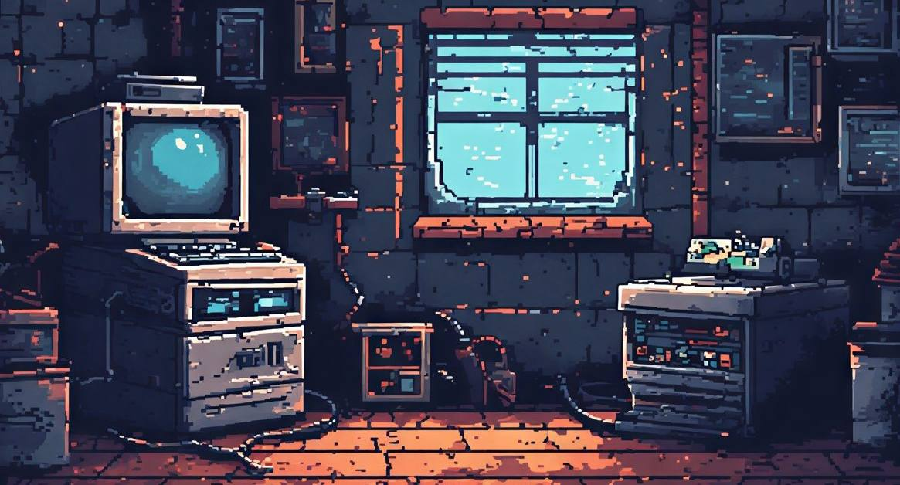

<div align="center">
  

  <br />
  <br />

  <a href="https://github.com/lz811">
    
  </a>

  <p><samp><b>liza@retro-pc:~$</b> ./explore --beyond-the-surface</samp></p>
  <p><i>Breaking things down to understand how they work.</i></p>

  
  
  
</div>

---

### `01 / PLAYER PROFILE`

```yaml
player: Liza
role: Cybersecurity Enthusiast & Developer
favorite_side_quest: Reverse Engineering
currently_at: École 42 
curiosity_level: MAX
```

I love the moment when a confusing binary starts making sense. I'm especially drawn to **reverse engineering**, **CTF challenges**, and **low-level programming** — the kind of problems that reward patience, curiosity, and a willingness to dig deeper.

Outside the debugger, I enjoy **OSINT** and following tiny clues until they form a bigger picture. My favorite way to learn is by experimenting, investigating, and figuring things out for myself.

### `02 / DEVELOPER INVENTORY`

<div align="center">
  
</div>

<br />

| 🧩 Programming & scripting | 🛠️ Security & debugging | ⚙️ Environment & workflow |
| :--- | :--- | :--- |
| Python · Rust · Assembly · Bash · HTML/CSS | GDB · Burp Suite · Wireshark | Linux · Git/GitHub · Docker |

### `03 / CURRENT QUESTS`

```text
╭────────────────────────────────────────────╮
│              ACTIVE QUESTS                 │
├────────────────────────────────────────────┤
│ [~]  Binary Exploitation                  │
│ [~]  Rust                                 │
│ [~]  Low-Level Programming                │
╰────────────────────────────────────────────╯
```

*The learning curve is part of the game.*

### `04 / SELECTED BUILDS`

<!-- FEATURED_PROJECTS_START -->
> 🎮 **Project slots are being prepared.** In the meantime, you can [explore my repositories](https://github.com/lz811?tab=repositories).

<!-- When you're ready, replace the block above with linked project cards, for example:
<a href="https://github.com/lz811/REPOSITORY-NAME">
  
</a>
-->
<!-- FEATURED_PROJECTS_END -->

### `05 / CHARACTER STATS`

<div align="center">
  <a href="https://github.com/lz811">
    
  </a>
  <a href="https://github.com/lz811?tab=repositories">
    
  </a>
</div>

<sub>Stats reflect public GitHub activity; language percentages describe repository code, not proficiency.</sub>

### `06 / CONTRIBUTION SNAKE`

<div align="center">
  <picture>
    <source media="(prefers-color-scheme: dark)" srcset="https://raw.githubusercontent.com/lz811/lz811/output/github-snake-dark.svg" />
    <source media="(prefers-color-scheme: light)" srcset="https://raw.githubusercontent.com/lz811/lz811/output/github-snake.svg" />
    
  </picture>
</div>

<div align="center">
  <br />
  
  <br />
  <sub><samp>EOF // Thanks for visiting my little corner of the internet.</samp></sub>
</div>
